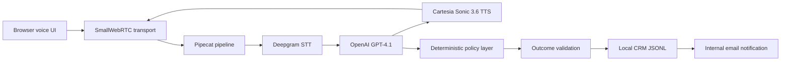

# Mumbai Bank Collections Voicebot — GreyLabs SPM Take-home

A browser-based prototype for respectful outbound credit-card collections conversations for customers 1–30 days overdue.

## What is implemented

- Browser voice pipeline using Pipecat + SmallWebRTC.
- Deepgram speech-to-text, OpenAI GPT-4.1 conversational reasoning, and Cartesia Sonic 3.6 text-to-speech.
- Prompt-level bank policy constraints and a deterministic intent/policy layer.
- Structured follow-up event persistence to local JSONL.
- Optional internal email notifications for callback/escalation events.
- Callback confirmation state flow and human-escalation routing logic.

## Important scope boundaries

This is a prototype, not a production collections platform:
- No real telephony, bank CRM, agent desktop, OTP verification, payment processing, or live human-transfer integration.
- Email is an internal notification adapter; it does not prove a callback was scheduled or a transfer completed.
- No customer account balance is exposed because OTP verification is not implemented.
- Callback capture has a known transcript-segmentation defect: in one observed call, the customer said “Tomorrow morning, 9 AM”, but the backend captured and persisted only “Tomorrow,”. The validator accepted the non-empty string. Treat callback preference capture as unreliable until fixed and re-tested.
- The policy classifier is regex-based and can miss paraphrases or produce false positives. It is a guardrail prototype, not a complete policy engine.

## Architecture



The diagram is logical: policy checks and event handling are orchestrated in the Pipecat application; this is not a separately deployed microservice.

## Repository layout

```text
.
├── README.md
├── PRODUCT_WRITEUP.pdf
├── docs/
│   ├── architecture.mmd
│   ├── evaluation-methodology.md
│   └── limitations-and-roadmap.md
├── server/
│   ├── bot.py
│   ├── policy.py
│   ├── crm.py
│   ├── requirements.txt
│   ├── .env.example
│   └── .gitignore
├── sample_data/
│   └── sample_outcomes.jsonl
├── tests/
│   └── test_policy.py
└── GreyLabs_Voicebot_Evaluation.xlsx
```

## Setup

Prerequisites: Python 3.12+ (the development machine used Python 3.14.9), Node.js/npm, and API credentials for Deepgram, OpenAI, and Cartesia.

1. Clone the repository.
2. Create a Python environment in `server` and install dependencies:
   ```powershell
   cd server
   python -m venv .venv
   .\.venv\Scripts\Activate.ps1
   pip install -r requirements.txt
   ```
3. Copy `.env.example` to `.env` and fill in credentials locally. Never commit `.env`.
4. Start the backend:
   ```powershell
   python bot.py
   ```
5. The original Pipecat scaffold includes a Vite/React browser client. If you include that client folder from your working project, install and run it from `client`:
   ```powershell
   npm install
   npm run dev
   ```

> The browser client scaffold is not duplicated in this submission bundle. Copy the existing `client/` directory from the working project into the repository before publishing if you want a fully runnable clone. The backend code is included here.

## Environment variables

Required: `DEEPGRAM_API_KEY`, `OPENAI_API_KEY`, `CARTESIA_API_KEY`.

Optional email adapter: `SMTP_HOST`, `SMTP_PORT`, `SMTP_USERNAME`, `SMTP_PASSWORD`, `FOLLOWUP_EMAIL_TO`. For Gmail, use an App Password stored only in `.env`, never in source control.

## Run policy unit tests

```powershell
cd server
python -m unittest discover -s ..\tests -v
```

## Evaluation

The evaluation workbook contains 15 scripted scenarios, a scenario-level result tracker, and an evidence log. Historical evidence is recorded separately from tests still requiring execution. Do not interpret the scripted set as statistically significant production performance.

Observed evidence includes conversational handling of PTP, already-paid, hardship, medical escalation, balance refusal, other-product scope control, Hinglish comprehension, and one callback persistence/email event. The callback event is a partial failure because the stored callback preference was truncated.

## Sample outcomes

See `sample_data/sample_outcomes.jsonl`. Values are synthetic/sanitized examples illustrating the event schema; they are not customer records.

## Before publishing

- Review the code against the exact latest local files, especially `policy.py` and `crm.py`.
- Copy the original `client/` folder into this repository if you want a complete runnable browser demo.
- Verify dependency versions with the working project's lockfile and test from a clean clone.
- Remove any local logs, credentials, customer data, and `.env` files.
